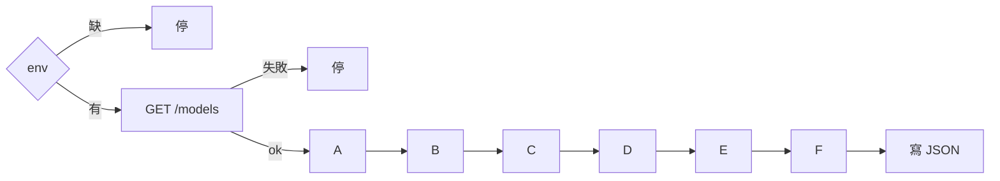
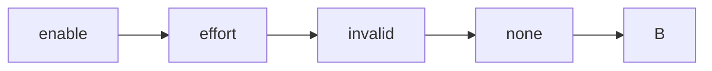

# 模型上架：腳本實際流程

對齊 `scripts/probe_flowchart.py`（`STEPS = A, B, C, D, E, F`）。  
用系統 `curl` 打 `GET /models` 與 `POST /chat/completions`。題目在 `configs/profiles/generic.json`。  
Gemma／Kimi 官方填法在 [PARAMS.md](./PARAMS.md)，**腳本不讀**。跑完看 `results/flowchart_*.json` 的 `meta.read`、`request`、`compare`。  
vLLM `--reasoning-parser`／`--tool-call-parser`、LiteLLM 是否丟參數：腳本當客戶端看不到，不列入步驟。

`.env`：`OPENAI_BASE_URL`、`OPENAI_API_KEY`、`MODEL`（必須是閘道 `/models` 上的 id）。

可選：
- `REASONING_EFFORT`（逗號分隔；空白＝掃 `low/medium/high/max/none`）
- `ENABLE_THINKING=true`（**僅 Gemma 4**；每槍帶 `chat_template_kwargs.enable_thinking=true`）

建議值與官網連結見 `env.example`。shell 已 `export` 的同名變數會蓋過 `.env`。

進 A 之後單題失敗**不中止**，記判定後繼續；最後才寫 `results/flowchart_<MODEL>_<時間>.json`。

每筆 JSON 含：
- `request`：實際 POST 欄位（不含完整 messages）→ 證明**有沒有送到**
- effort 槍另含 `compare`（優先 `usage.completion_tokens_details.reasoning_tokens`，沒有才用字數）

| `compare` | 值 | 意思 |
|-----------|----|------|
| `vs_default` | `like_default` / `not_default` / `unknown` | 像不像不帶參數的那槍 |
| `vs_max` | `like_max` / `not_like_max` / `null` | 像不像本次的 `max` 槍（沒掃 max 則 null） |
| `this` / `default` / `max` | 數字 | 本次／預設／max 的思考量 |

`like_default`（或像已確認為預設的 `max`）→ **不是獨立檔**。`not_default` 只證明不是預設，**不能**證明就是官方的 `medium`／`high`。

考卷三句：

| 鍵 | 用於 | 內容 |
|----|------|------|
| `prompt` | A、D 第一槍、E、F.stream_reasoning | 3+5 只回數字 |
| `prompt_json` | B、F.schema_reasoning | 只要 JSON `{"ok":true,"n":1}` |
| `prompt_tool` | C、D.tool_delta、F.stream_tools | 請用 tool 查台北天氣 |

---

## A reasoning（`step_a`，唯一有分支）

探測閘道有沒有 thinking／`reasoning_effort`。掃哪些字看 `REASONING_EFFORT`；沒設則用 `low/medium/high/max/none`（探測聯集，不是每個模型官方都有）。非 200 記 SKIP。

**Gemma 4 在此閘道能判的只有「會不會想／能不能關」**，不能判 `low`/`medium`/`high` 想得多深：vLLM 對 Gemma 的 `reasoning_effort` 主要是注入 `enable_thinking`，回應多半沒有 `reasoning_tokens`，字數比強度不可靠。`ENABLE_THINKING=true` 時預設已經在想，effort 槍會全像預設——腳本會標 `intensity_testable=false`，不再當成「參數沒生效」。Kimi 才適合用 `reasoning_tokens` 比強度。

依序 POST：`enable` → 各檔 effort → `invalid` →（有設 `none` 才打）→（`enable` 是 200 才打 `multiturn`）→ B。

| case_id | 請求 | 判定 |
|---------|------|------|
| `A.enable` | 不帶 extra | 有 `reasoning`／`reasoning_content` → OK；200 無欄位 → NOOP；非 200 → FAIL |
| `A.effort_low` … `A.effort_max` | `reasoning_effort=<該字>` | 非 200 → SKIP；200 無欄位 → NOOP。**`ENABLE_THINKING=true` 時不比強度**（`compare.intensity_testable=false`），有 reasoning 只記「有送到」。未強制 thinking 時：`like_default` → NOOP；`not_default` → OK（只證明不是預設）。Gemma 在此閘道多半**沒有 `reasoning_tokens`**，不能用字數判斷 low/high |
| `A.effort_invalid` | `reasoning_effort=not-a-level` | ≥400 → OK；200 → NOOP（沒在驗證枚舉） |
| `A.effort_none` | `reasoning_effort=none` | 非 200 → SKIP；仍有 reasoning → NOOP |
| `A.multiturn` | 把 `A.enable` 的 assistant（含 reasoning）塞回再問一次 | 僅 enable 為 200 才打；該槍 200 → OK |

---

## B json（`step_b`）

四次 POST，固定順序。有 reasoning 時**只 parse `content`**。

| case_id | 請求 | 判定 |
|---------|------|------|
| `B.none` | 不帶 `response_format` | 200 → OK（不一定是 JSON） |
| `B.json_object` | `{"type":"json_object"}` | 200 且 `content` 可 `json.loads` → OK；200 但不是 JSON → NOOP |
| `B.json_schema` | 固定 schema（`ok` bool、`n` int、`strict`） | 同上 |
| `B.string_json` | `"response_format":"json"`（非法字串） | ≥400 → OK；200 → NOOP |

---

## C tools（`step_c`）

三次 POST，同一個 weather function。`tool_choice` 依序 `auto` → `required` → `none`。

| case_id | 請求 | 判定 |
|---------|------|------|
| `C.auto` | `tool_choice=auto` | 200 → OK；無 `tool_calls` 只記 notes（模型可以選擇不叫） |
| `C.required` | `required` | 200 且有 `tool_calls` → OK；200 但沒叫 → NOOP |
| `C.none` | `none` | 200 且沒有 `tool_calls` → OK；仍有 → NOOP |

---

## D stream（`step_d`）

兩次 HTTP：

1. `stream=true` + `prompt` → 同一份回應連記三列  
2. `stream=true` + tools + `tool_choice=required` → `D.tool_delta`

| case_id | 來源 | 判定 |
|---------|------|------|
| `D.sse` | 第一槍 | 200 且 content 或 reasoning 非空 → OK |
| `D.reasoning_delta` | 同一份 | 有獨立 reasoning delta → OK，否則 NOOP |
| `D.done` | 同一份 | 200 且看到 `[DONE]` → OK |
| `D.tool_delta` | 第二槍 | 200 → OK；沒看到 tool_calls delta 只記 notes |

---

## E temperature（`step_e`）

| case_id | 請求 | 判定 |
|---------|------|------|
| `E.temperature` | `temperature=0.2` | 200 → OK；否則 FAIL |

腳本不管官方能不能改 sampling。官方若固定不可改而閘道仍 200，看該次 JSON 的 `E.temperature`（`request` 有 `temperature`、`verdict` 為 pass 即閘道接受）。

---

## F combo（`step_f`）

三次 POST，固定順序。

| case_id | 請求 | 判定 |
|---------|------|------|
| `F.schema_reasoning` | json_schema + `prompt_json` | 200 且 content 是 JSON → OK |
| `F.stream_reasoning` | stream + `prompt` | 200 且有 content 或 reasoning → OK |
| `F.stream_tools` | stream + tools `auto` | 200 → OK |

---

## 判定

| 終端 | `verdict` | 何時 |
|------|-----------|------|
| OK | `pass` | 這題預期成立 |
| FAIL | `fail` | 應成功卻失敗 |
| NOOP | `noop` | 2xx 但欄位／行為沒對上 |
| SKIP | `skip` | 該檔 `reasoning_effort` 非 200 |

怎麼跑見 [README.md](./README.md)。
