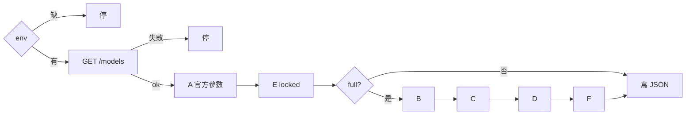
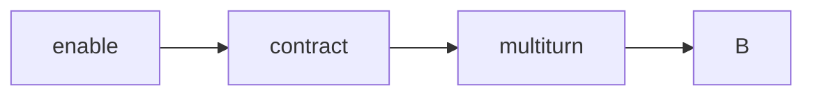

# 模型上架：腳本實際流程

預設 `PROBE_SCOPE=official`：測該模型**官方網站列出的特殊參數**是否有效，回覆必須符合**官方文件寫死的那層**（欄位有／無、應 4xx），**不是**範例作文全文，也**不是**思考量排名。

對齊 `scripts/probe_flowchart.py`。流程圖見 [FLOWCHART.md](./FLOWCHART.md)。  
`PROBE_SCOPE=full` 才跑 baseline `A, B, C, D, E, F` 通用考卷。  
用系統 `curl` 打 `GET /models` 與 `POST /chat/completions`。題目在 `configs/profiles/generic.json`。  
官方契約在 `configs/models/`（有模型商／NIM 官方文件就以官方為準；`source` 列出處。加 JSON 即可測新 family）。[PARAMS.md](./PARAMS.md) 是人讀說明。跑完看 `results/flowchart_*.json` 與同名 `.md`；**輸出欄位說明見 [README.md](./README.md)「結果」**。JSON 的 `meta.read` 與文件相同，讀檔不必再翻。  
vLLM `--reasoning-parser`／`--tool-call-parser`、LiteLLM 是否丟參數：腳本當客戶端看不到，不列入步驟。

`.env`：`OPENAI_BASE_URL`、`OPENAI_API_KEY`、`MODEL`（必須是閘道 `/models` 上的 id）。

可選：
- `PROBE_SCOPE=official|full`（預設 `official`）
- `REASONING_EFFORT`（逗號分隔；空白＝該 Profile 官方枚舉，不是聯集）
- `PROBE_MODE=probe|enforce`

`ENABLE_THINKING` **已忽略**：Gemma 的 `chat_template_kwargs.enable_thinking` 由 Profile `flag` 產生獨立對照槍，不再插入每一槍。

建議值與官網連結見 `env.example`。shell 已 `export` 的同名變數會蓋過 `.env`。

進 A 之後單題失敗**不中止**，記判定後繼續；最後才寫 `results/flowchart_<MODEL>_<時間>.json` 與同名 `.md` 對照表。

每筆 JSON 含：
- `request`：實際 POST 欄位（不含完整 messages）→ 證明**有沒有送到**
- official scope 的 effect 槍含 `official`（文件寫死的回覆欄位）
- `full` 的 effort 槍另含 `compare`（優先 `usage.completion_tokens_details.reasoning_tokens`，沒有才用字數；**不算**官方證明）

| `compare`（僅 `full`） | 值 | 意思 |
|-----------|----|------|
| `vs_default` | `like_default` / `not_default` / `unknown` | 像不像不帶參數的那槍 |
| `vs_max` | `like_max` / `not_like_max` / `null` | 像不像本次的 `max` 槍（沒掃 max 則 null） |
| `this` / `default` / `max` | 數字 | 本次／預設／max 的思考量 |

`like_default`（或像已確認為預設的 `max`）→ **不是獨立檔**。`not_default` 只證明不是預設，**不能**證明就是官方的 `medium`／`high`。

考卷三句（`full` 才用；`official` 的官網範例槍用 Profile 裡的原文 prompt）：

| 鍵 | 用於 | 內容 |
|----|------|------|
| `prompt` | A、D 第一槍、E、F.stream_reasoning | `generic.json` 的 `prompt` |
| `prompt_json` | B、F.schema_reasoning | 只要 JSON `{"ok":true,"n":1}` |
| `prompt_tool` | C、D.tool_delta、F.stream_tools | 請用 tool 查台北天氣 |

---

## official scope（預設；文件寫死的回覆層）

只跑 Profile `params[]` 與 `official_examples`。跳過 B–F、`A.enable`、`A.multiturn`、未鎖定的 `E.temperature`。契約槍**每槍獨立 nonce**（避免閘道依 messages 快取而忽略 extra）。官網範例槍**不加 nonce**，prompt 必須是文件原文。

判定只看官方寫死的那層：

| 文件寫什麼 | 判定 |
|------------|------|
| 回 `content` + `reasoning_content` | 兩欄非空 → OK（閘道 `reasoning` 當別名） |
| 關 thinking 後不回 reasoning | `content` 非空且**沒有** reasoning → OK；仍有 → FAIL |
| 該參數應拒（例如 Kimi 改 temperature） | 4xx → OK；200 → FAIL |
| 官網範例同一句 prompt | 檢查官方說的欄位，**不比全文** |

`reasoning_tokens` 檔位排名**不是**這層的證明。

---

## A reasoning（`step_a`，`full` 才有 `A.enable`）

探測閘道有沒有 thinking／`reasoning_effort`。掃哪些值由命中的 `configs/models/*.json` 決定，不是聯集。未知模型不掃 effort。**4xx 記 SKIP；5xx／timeout 記 FAIL。**

**Gemma 4** 只打 Google 官方開關 `chat_template_kwargs.enable_thinking`（不汙染 JSON/tools）。不掃 vLLM 的 `reasoning_effort`／`include_reasoning`。Kimi 才用 `reasoning_tokens` 比強度。

依序（`full`）：`A.enable`（省略 extra）→ Profile 產生的契約槍（flag / enum / int_range / forbidden）→ `A.official_*`（官網範例欄位）→ `A.multiturn` → B。

`A.official_*` 用官網原文 prompt＋request，**強制非串流**。`official.matches_example` 只證明文件寫死的回覆欄位（`content`／`reasoning_content` 非空，或關思考後不該出現 reasoning），**不是**官方全文標準答案。

| case_id | 請求 | 判定 |
|---------|------|------|
| `A.enable` | 不帶 extra | 有 `reasoning`／`reasoning_content` → OK；200 無欄位 → NOOP；非 200 → FAIL |
| Profile `flag` | 例如 `enable_thinking=true/false` | effect：有／無 reasoning 欄位。獨立一槍，不插入 B–F |
| Profile `enum` 合法值 | 例如 `reasoning_effort=low` | 4xx → SKIP；5xx → FAIL；Gemma 看有無 reasoning；Kimi 用 token 比是否異於預設 |
| Profile `enum` 非法值 | 官方 `reject` + `invalid_example` | **4xx → OK**；**200 → FAIL**（閘道比官方寬）；**5xx → FAIL** |
| `A.official_*` | 官網原文 prompt＋request | 文件寫死的回覆欄位符合 → OK；缺欄／不該出現卻出現／非 200 → FAIL。**不比全文** |
| `A.multiturn` | 把 `A.enable` 的 assistant（含 reasoning）塞回再問一次 | 僅 enable 為 200 才打；該槍 200 → OK |

---

## B json（`step_b`）

四次 POST，固定順序。有 reasoning 時**只 parse `content`**。

| case_id | 請求 | 判定 |
|---------|------|------|
| `B.none` | 不帶 `response_format` | 200 → OK（不一定是 JSON） |
| `B.json_object` | `{"type":"json_object"}` | 200 且 `content` 可 `json.loads` → OK；200 但不是 JSON → NOOP |
| `B.json_schema` | 固定 schema（`ok` bool、`n` int、`strict`、不可多欄） | 200 且 content **符合 schema** → OK；200 但只是別的 JSON → NOOP |
| `B.string_json` | `"response_format":"json"`（非法字串） | **4xx → OK**；200 → NOOP；**5xx → FAIL** |

---

## C tools（`step_c`）

三次 POST，同一個 weather function。`tool_choice` 依序 `auto` → `required` → `none`。

| case_id | 請求 | 判定 |
|---------|------|------|
| `C.auto` | `tool_choice=auto` | 200 → OK；無 `tool_calls` 只記 notes（模型可以選擇不叫） |
| `C.required` | `required` | 200 且有 `tool_calls` → OK；200 但沒叫 → NOOP |
| `C.none` | `none` | 200 且沒有 `tool_calls` → OK；仍有 → NOOP |

---

## D stream（`step_d`）

兩次 HTTP：

1. `stream=true` + `prompt` → 同一份回應連記三列  
串流會組回 `tool_calls`、最後一包 `usage`、`finish_reason`。`D.tool_delta` 用 `tool_choice=required`，沒叫工具不算通過。

| case_id | 來源 | 判定 |
|---------|------|------|
| `D.sse` | 第一槍 | 200 且 content 或 reasoning 非空 → OK |
| `D.reasoning_delta` | 同一份 | 有獨立 reasoning delta → OK，否則 NOOP |
| `D.done` | 同一份 | 200 且看到 `[DONE]` → OK |
| `D.tool_delta` | 第二槍 | 200 且有 tool_calls／delta → OK；200 但沒叫 → NOOP |

---

## E sampling（`step_e`）

Profile 若宣告 `kind=locked`（Kimi 的 `temperature` / `top_p`），走契約 **reject**：4xx → OK；200 → FAIL（閘道比官方寬）；5xx → FAIL。

未宣告 locked 時仍打一槍 `temperature=0.2`：200 → **NOOP**（只證明閘道接受，不證明 sampling 生效）；4xx → SKIP；5xx → FAIL。

---

## F combo（`step_f`）

先打**這家契約的思考開關 × 串流開關**（2 或 4 槍），再打三次通用 POST。組合槍**不理** `STREAM_STEPS`，開／關串流是題目本身。沒有思考開關的 family 跳過組合槍。

| case_id | 請求 | 判定 |
|---------|------|------|
| `F.think_on_stream` / `F.think_on_sync` | 官方「開思考」+ 串流／非串流 | 200；`content` 與 reasoning **都非空** |
| `F.think_off_stream` / `F.think_off_sync` | 官方「關思考」檔（若有） | 能關：content 非空且**沒有** reasoning；官方關了仍會想（如 MiniMax M2）：仍要有 reasoning |
| `F.schema_reasoning` | json_schema + `prompt_json` | 200 且 content **符合 schema** `{ok, n}` → OK |
| `F.stream_reasoning` | stream + `prompt`（不帶思考 extra） | 200 且有 content 或 reasoning → OK |
| `F.stream_tools` | stream + tools `auto` | 200 → OK；無 tool_calls 只記 notes |

Kimi／gpt-oss 官方不能關思考：只有「開」× 串流兩槍。`reasoning_effort` 只取開／關兩極，不掃 low／medium／high 每一檔。

---

## 判定

| 終端 | `verdict` | 何時 |
|------|-----------|------|
| OK | `pass` | 這題預期成立 |
| FAIL | `fail` | 應成功卻失敗；非法參數回 **5xx** |
| NOOP | `noop` | 2xx 但欄位／行為沒對上，或只證明閘道接受、無法證明生效 |
| SKIP | `skip` | 該參數 **4xx** 不接受 |

怎麼跑見 [README.md](./README.md)。
