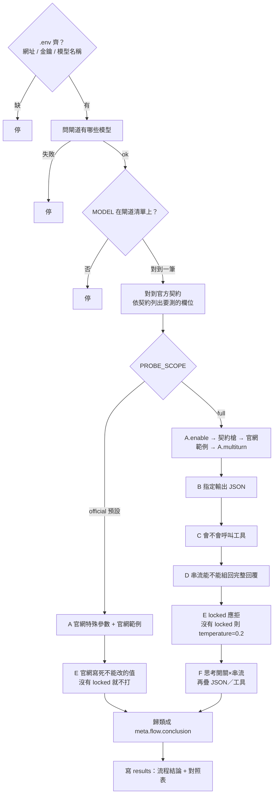
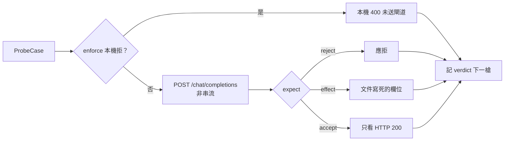

# 探測流程圖

對齊 `scripts/probe_flowchart.py` 與 [ARCHITECTURE.md](./ARCHITECTURE.md)。

預設 `PROBE_SCOPE=official`：測該模型**官方網站列出的特殊參數**是否有效，回覆必須符合**官方文件寫死的那層**（欄位有／無、應 4xx）。**不是**範例作文全文，也**不是**思考量排名。

這是**一支腳本**。`PROBE_SCOPE` 決定步驟清單，也決定 A、E 裡面打哪些槍。預設 `official` 只跑 A、E；`full` 跑 A、B、C、D、E、F。

單題失敗**不中止**；最後才寫 `results/flowchart_<MODEL>_<時間>.json` 與同名 `.md` 對照表。

```text
.env 的 MODEL
  → 對上閘道 id
  → 找出這家模型的官方契約（configs/models/ 裡對應的 JSON）
  → 自動列出「這家有哪些特殊參數、回覆該有哪些欄」
  → 打 POST {OPENAI_BASE_URL}/chat/completions
  → 寫 results 對照表（官方該怎樣 / 閘道實際怎樣 / 哪裡不對）
```

新模型只要補一份契約 JSON 就能測，不必改探測步驟。腳本只看進出的 JSON，看不到閘道轉發內容。

---

## 整次探測

`.env` 必填：`OPENAI_BASE_URL`、`OPENAI_API_KEY`、`MODEL`（必須是閘道 `GET /models` 上的 id）。



`PROBE_SCOPE` 不是 `official`／`full`、`PROBE_MODE` 不是 `probe`／`enforce`、或系統沒有 `curl`，都在問閘道之前停。MODEL 不在 `GET /models` 也停；只有大小寫不同、且只對到一筆時，改用閘道那筆 id。

寫檔前固定走四段：對上模型 →（有 `VLLM_BASE_URL` 才讀旗標）→ 探測 → 把同一類問題收成 `meta.flow.conclusion`。旗標在開打前讀；歸類在全部槍打完後做。單題失敗仍不中止。

沒有官方特殊參數、也沒有官網範例時，`official` 的 A、E 都沒有槍（空結果）。`full` 仍打 `A.enable`、`A.multiturn`（enable 為 200 才打）、B–D、`E.temperature`、F。

---

## official 每一槍

nonce、非串流與欄位規則見 [ARCHITECTURE.md](./ARCHITECTURE.md)「official scope」。



狀態碼見 [ARCHITECTURE.md](./ARCHITECTURE.md)「判定」。`reasoning_tokens` 檔位排名不是這層的證明。契約槍種類見同一份的 A–F。

怎麼跑見 [README.md](./README.md)。family 清單見 [configs/models/README.md](./configs/models/README.md)。
