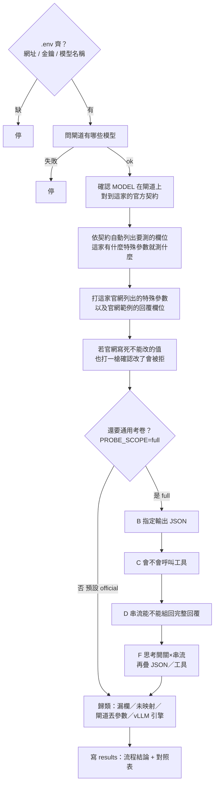
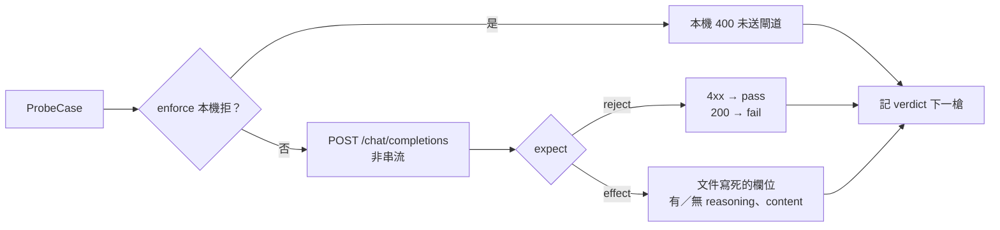
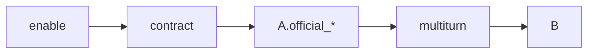

# 探測流程圖

對齊 `scripts/probe_flowchart.py` 與 [ARCHITECTURE.md](./ARCHITECTURE.md)。

預設 `PROBE_SCOPE=official`：測該模型**官方網站列出的特殊參數**是否有效，回覆必須符合**官方文件寫死的那層**（欄位有／無、應 4xx）。**不是**範例作文全文，也**不是**思考量排名。

這是**一條探測**，不是兩套腳本。`PROBE_SCOPE` 只決定走完官方參數後**要不要繼續**打 JSON／工具／串流／組合。預設在官方參數停；`full` 把同一條路走完。

單題失敗**不中止**；最後才寫 `results/flowchart_<MODEL>_<時間>.json` 與同名 `.md` 對照表。

```text
.env 的 MODEL
  → 對上閘道 id
  → 找出這家模型的官方契約（configs/models/ 裡對應的 JSON）
  → 自動列出「這家有哪些特殊參數、回覆該有哪些欄」
  → 打 POST /v1/chat/completions
  → 寫 results 對照表（官方該怎樣 / 閘道實際怎樣 / 哪裡不對）
```

新模型只要補一份契約 JSON 就能測，不必改探測步驟。腳本只看進出的 JSON，看不到閘道轉發內容。

---

## 整次探測

`.env` 必填：`OPENAI_BASE_URL`、`OPENAI_API_KEY`、`MODEL`（必須是閘道 `GET /models` 上的 id）。



寫檔前固定走四段：對上模型 →（有 `VLLM_BASE_URL` 才讀旗標）→ 探測 → 把同一類問題收成 `meta.flow.conclusion`。單題失敗仍不中止。

`full` 在 B 之前還會多打：預設會不會思考（`A.enable`）、多輪回填 assistant（`A.multiturn`）、以及未鎖定的 temperature（E 多一槍「閘道接不接受」）。

| 走到哪裡停 | 跑什麼 | 不跑什麼 |
|------------|--------|----------|
| `official`（預設） | 上面主幹：這家官網特殊參數、官網範例、官方寫死不能改的值 | JSON／工具／串流／思考×串流組合；未鎖定的 temperature |
| `full` | 同一條主幹走完，再加上 B–F | — |

不要把兩段合成「每次都打 A–F」：官方契約與通用考卷證明的不是同一件事；預設打完全部會又慢又把 JSON／工具失敗當成「官方參數不合格」。對不上任何一家契約時，`official` 主幹沒槍可打（空結果）；`full` 仍走 B–F。

---

## official 每一槍

契約槍**每槍獨立 nonce**（避免閘道依 messages 快取而忽略 extra）。官網範例槍**不加 nonce**，prompt 必須是文件原文。official 一律非串流。



每一槍怎麼判見 [ARCHITECTURE.md](./ARCHITECTURE.md)「official scope」。`reasoning_tokens` 檔位排名**不是**這層的證明。

---

## A 契約槍

`full` 才有 `A.enable` → 契約槍 → `A.official_*` → `A.multiturn`。`official` 只跑契約槍與官網範例。



| kind | 例子 | 判定重點 |
|------|------|----------|
| `flag` | Gemma `chat_template_kwargs.enable_thinking` true/false | 有／無 reasoning 欄位 |
| `enum` 合法 | Kimi `reasoning_effort=low\|high\|max` | 200 且文件寫死的回覆形狀 |
| `enum` 非法 | `not-a-level`；Kimi `none`／`medium` | **4xx → OK**；**200 → FAIL** |
| `int_range` | Nemotron `reasoning_budget` | 範圍內 effect；超出應拒 |
| `forbidden` | 不該出現的參數 | 送了應 4xx |
| `official_examples` | 官網原文 prompt + request | 欄位形狀；不加 nonce |
| `locked`（E） | Kimi `temperature`／`top_p` | 改了應 4xx |

`ENABLE_THINKING` env **已忽略**：Gemma 的開關由 Profile `flag` 產生獨立對照槍，不插入 B–F。

---

怎麼跑、**結果檔欄位**見 [README.md](./README.md)。family 清單見 [configs/models/README.md](./configs/models/README.md)。判定表只維護在 [ARCHITECTURE.md](./ARCHITECTURE.md)「判定」。
