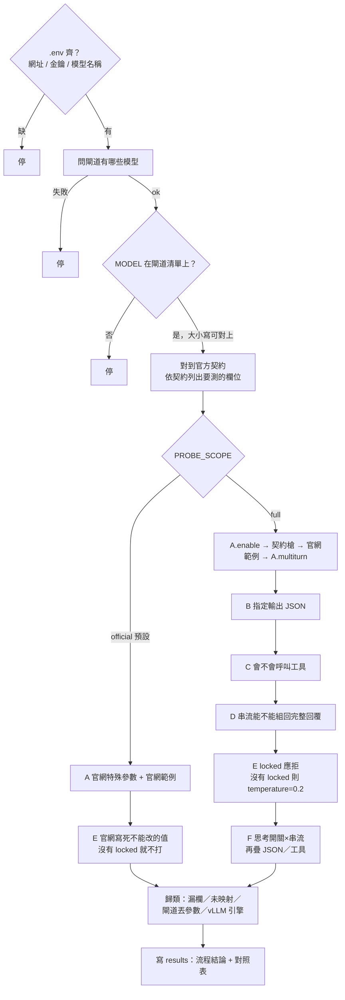
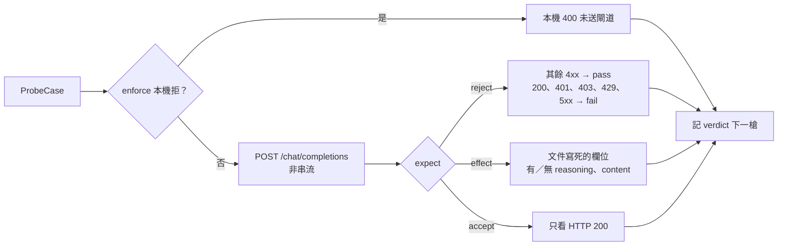
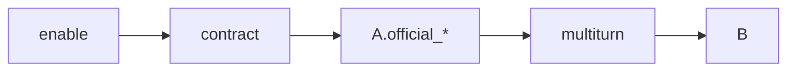

# 探測流程圖

對齊 `scripts/probe_flowchart.py` 與 [ARCHITECTURE.md](./ARCHITECTURE.md)。

預設 `PROBE_SCOPE=official`：測該模型**官方網站列出的特殊參數**是否有效，回覆必須符合**官方文件寫死的那層**（欄位有／無、應 4xx）。**不是**範例作文全文，也**不是**思考量排名。

這是**一支腳本**。`PROBE_SCOPE` 決定步驟清單，也決定 A、E 裡面打哪些槍。預設 `official` 只跑 A、E；`full` 跑 A、B、C、D、E、F。

單題失敗**不中止**；最後才寫 `results/flowchart_<MODEL>_<時間>.json` 與同名 `.md` 對照表。

```text
.env 的 MODEL
  → 對上閘道 id
  → 找出這家模型的官方契約（configs/models/ 裡對應的 JSON）
  → 自動列出「這家有哪些特殊參數、回覆該有哪些欄」
  → 打 POST {OPENAI_BASE_URL}/chat/completions
  → 寫 results 對照表（官方該怎樣 / 閘道實際怎樣 / 哪裡不對）
```

新模型只要補一份契約 JSON 就能測，不必改探測步驟。腳本只看進出的 JSON，看不到閘道轉發內容。

---

## 整次探測

`.env` 必填：`OPENAI_BASE_URL`、`OPENAI_API_KEY`、`MODEL`（必須是閘道 `GET /models` 上的 id）。



`PROBE_SCOPE` 不是 `official`／`full`、`PROBE_MODE` 不是 `probe`／`enforce`、或系統沒有 `curl`，都在問閘道之前停。MODEL 不在 `GET /models` 也停；只有大小寫不同、且只對到一筆時，改用閘道那筆 id。

寫檔前固定走四段：對上模型 →（有 `VLLM_BASE_URL` 才讀旗標）→ 探測 → 把同一類問題收成 `meta.flow.conclusion`。旗標在開打前讀；歸類在全部槍打完後做。單題失敗仍不中止。

`A.enable` 與 `A.multiturn` 在 `step_a` 裡面，只在 `full` 出現，而且在 B 之前。未鎖定的 `temperature=0.2` 是 `step_e`，`full` 排在 D 之後、F 之前，不是 B 之前。

| 範圍 | 順序 | 不跑什麼 |
|------|------|----------|
| `official`（預設） | A 契約槍與官網範例，然後 E（只有 locked） | `A.enable`、`A.multiturn`、B–D、F、未鎖定的 temperature |
| `full` | A（含 enable、契約槍、官網範例、multiturn）→ B → C → D → E → F | — |

不要把兩段合成「每次都打 A–F」：官方契約與通用考卷證明的不是同一件事；預設打完全部會又慢又把 JSON／工具失敗當成「官方參數不合格」。對不上任何一家契約時，`official` 的 A、E 都沒有槍（空結果）；`full` 仍打 `A.enable`、`A.multiturn`（enable 為 200 才打）、B–D、`E.temperature`、F。

---

## official 每一槍

契約槍**每槍獨立 nonce**（避免閘道依 messages 快取而忽略 extra）。官網範例槍**不加 nonce**，prompt 必須是文件原文。official 一律非串流。



每一槍怎麼判見 [ARCHITECTURE.md](./ARCHITECTURE.md)「official scope」。`reasoning_tokens` 檔位排名**不是**這層的證明。

---

## A 契約槍

`full` 才有 `A.enable` → 契約槍 → `A.official_*` → `A.multiturn`。`official` 只跑契約槍與官網範例。

下面這張是 `full`。`official` 沒有 enable、multiturn，A 之後進 E，不進 B。



契約槍產生順序是 flag → enum → int_range → forbidden → 官網範例。`A.multiturn` 不在這串裡面，而是 `A.enable` 為 200 之後另打。

| kind | 例子 | 判定重點 |
|------|------|----------|
| `flag` | Gemma `chat_template_kwargs.enable_thinking` true/false | official：true 要 content 與 reasoning 都非空；false 要 content 非空且沒有 reasoning。full 的 true 只看有沒有獨立 reasoning 欄 |
| `enum` 合法 | Kimi `reasoning_effort=low\|high\|max` | official：200 且 content、reasoning 欄都在，不排名。full 且 effect 是 `reasoning_tokens_rank`：4xx → SKIP；200 後用思考量比是否異於預設 |
| `enum` 非法 | `not-a-level`；Kimi `none`／`medium` | **4xx → OK**；**200 → FAIL**；401／403／429／5xx → FAIL |
| `int_range` | Nemotron `reasoning_budget` | 範圍內走 effect（這家是有 reasoning）；超出應 4xx。5xx 與 401／429 仍是 FAIL |
| `forbidden` | Kimi 不該送的 `thinking` | 送了應 4xx；200 → FAIL |
| `official_examples` | 官網原文 prompt + request | 欄位形狀；不加 nonce；強制非串流 |
| `locked`（E） | Kimi `temperature`／`top_p` | 改了應 4xx；200 → FAIL。有 locked 就不再打 `E.temperature` |

`ENABLE_THINKING` env **已忽略**：Gemma 的開關由 Profile `flag` 產生獨立對照槍，不插入 B–F。

---

怎麼跑、**結果檔欄位**見 [README.md](./README.md)。family 清單見 [configs/models/README.md](./configs/models/README.md)。判定表只維護在 [ARCHITECTURE.md](./ARCHITECTURE.md)「判定」。
